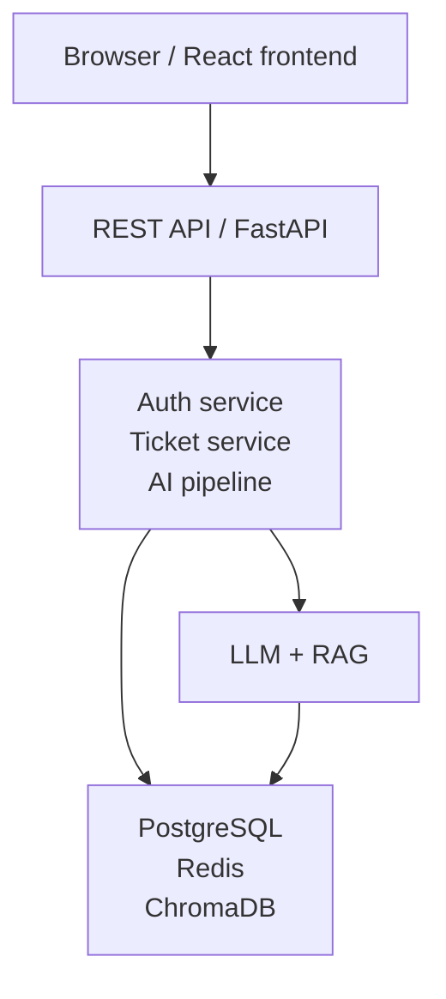

# AI Customer Support Automation System

An AI-assisted customer support workspace for classifying tickets, grounding responses in a knowledge base, and routing high-risk conversations to human support.

[](https://react.dev/)
[](https://www.typescriptlang.org/)
[](https://vite.dev/)
[](https://fastapi.tiangolo.com/)
[](https://www.postgresql.org/)
[](https://tailwindcss.com/)

## Live Demo

[Deployment URL placeholder](https://ai-system-ad7n-e1zg46rev-23eg107f01-3181s-projects.vercel.app/login)

This repository does not currently publish a production deployment URL.

## Overview

Support teams need to move quickly without losing context, consistency, or human judgment. This system accepts customer requests, analyzes their category and sentiment, retrieves relevant knowledge, and produces a grounded support response when automation is appropriate. Tickets that need human attention are surfaced in an escalation workflow, while managers can review operational metrics and administrators can manage the knowledge base. The frontend is a responsive React workspace backed by REST APIs and controlled React Query refresh.

## Key Features

### Frontend

- Responsive authenticated workspace with role-aware navigation
- Dashboard for ticket, escalation, SLA, and AI-quality data returned by the API
- Ticket creation through the support chat workflow
- Responsive ticket list with search, filtering, sorting, and mobile cards
- Ticket detail view explaining available AI analysis and workflow stages
- Reusable TypeScript UI system for forms, cards, badges, dialogs, states, and tables
- API-driven loading, empty, error, retry, permission, and not-found states
- Near-real-time operational refresh using controlled React Query polling
- Accessible forms, keyboard-operable controls, focus states, labels, live regions, and responsive alternatives

### AI workflow

- Ticket classification
- Sentiment detection
- Automatic escalation decisions
- Retrieval-augmented, knowledge-grounded responses
- Response quality scoring

### Backend

- FastAPI REST API
- PostgreSQL support through SQLAlchemy and Alembic
- Redis integration for token blacklisting, session-related state, and rate-limit support
- JWT access and refresh tokens
- ChromaDB for document embeddings and similarity retrieval

## Frontend Engineering Highlights

- **React + TypeScript:** Page and component contracts are typed, with explicit API response interfaces in the frontend.
- **Reusable components:** Shared primitives include `Button`, `Input`, `FormField`, `Card`, `Badge`, `Dialog`, `PageHeader`, `EmptyState`, `ErrorState`, `Skeleton`, and domain-specific status badges.
- **React Query data handling:** Operational queries use shared query keys, bounded stale times, cached data during background refresh, manual invalidation, retry actions, and foreground-only polling.
- **Responsive layouts:** Desktop tables transition to mobile cards where a dense table would be unusable. The shell supports a collapsible desktop sidebar and an accessible mobile drawer.
- **REST API integration:** Axios centralizes API access, bearer-token injection, timeout handling, and refresh-token retry behavior.
- **Route-based code splitting:** Page modules are loaded with `React.lazy` and rendered through a shared `Suspense` loader. The chart-heavy dashboard is isolated in its own route chunk.
- **Accessibility work:** Semantic forms and tables, associated labels, keyboard interactions, visible focus rings, `aria-live` feedback, dialog semantics, and permission-aware states are implemented throughout the main workflows.
- **Resilient UI states:** Major API interactions distinguish initial loading from background refresh and provide meaningful loading, empty, error, retry, forbidden, and missing-resource states.

## Architecture



The frontend communicates with FastAPI through REST endpoints. FastAPI coordinates authentication, ticket processing, knowledge retrieval, persistence, and AI response generation. PostgreSQL is the relational persistence target, Redis is optional/configurable, and ChromaDB stores retrieval vectors.

## AI Ticket Pipeline

```mermaid
flowchart LR
    Ticket["Ticket"] --> Validation["Validation and sanitization"]
    Validation --> Classification["Classification"]
    Classification --> Sentiment["Sentiment detection"]
    Sentiment --> Escalation["Escalation decision"]
    Escalation --> Retrieval["Knowledge retrieval"]
    Retrieval --> Response["Generated response"]
    Response --> Quality["Quality scoring"]
```



The backend also records ticket and AI-processing data used by the dashboard, audit logging, escalation queue, and ticket detail views. The exact path can vary when a ticket is escalated or when retrieval is unavailable.

## Tech Stack

### Frontend

| Area | Technology |
|---|---|
| UI | React 18 |
| Language | TypeScript |
| Build tool | Vite |
| Styling | Tailwind CSS 4 |
| Routing | React Router |
| HTTP client | Axios |
| Server state | React Query v3 |
| Charts | Recharts |
| Icons | Lucide React |

### Backend and AI

| Area | Technology |
|---|---|
| API | FastAPI, Uvicorn |
| Language | Python 3.11+ |
| Relational database | PostgreSQL via SQLAlchemy and Alembic |
| Local development fallback | SQLite configuration is supported |
| Cache and token state | Redis |
| Vector database | ChromaDB |
| LLM integration | Groq and LangChain integrations |
| Embeddings | Sentence Transformers |
| Authentication | JWT, bcrypt, refresh-token rotation |
| Document parsing | PyMuPDF and python-docx |

## Screenshots

Screenshots are intentionally represented as placeholders until a deployment or approved capture set is available.

| Screen | Placeholder |
|---|---|
| Login | `docs/screenshots/login.png` |
| Dashboard | `docs/screenshots/dashboard.png` |
| Tickets | `docs/screenshots/tickets.png` |
| AI Ticket Detail | `docs/screenshots/ticket-detail.png` |

No screenshot files are currently committed to the repository.

## Running Locally

### Prerequisites

- Node.js and npm
- Python 3.11 or newer
- Docker and Docker Compose for the containerized setup
- A Groq API key for AI response generation
- PostgreSQL and Redis when running the production-style configuration locally

### Docker Compose

1. Copy the backend environment template and configure the required values:

   ```bash
   cp backend/.env.example backend/.env
   ```

   On Windows PowerShell, use `Copy-Item backend/.env.example backend/.env`.

2. Set the required secrets and service values in `backend/.env`, especially `GROQ_API_KEY`, `DATABASE_URL`, and `JWT_SECRET`.

3. Start the services:

   ```bash
   docker compose up --build
   ```

4. Apply database migrations:

   ```bash
   docker exec aicsa-backend alembic upgrade head
   ```

5. Optionally ingest the repository knowledge-base documents:

   ```bash
   docker exec aicsa-backend python scripts/ingest_kb.py --folder /app/knowledge_base
   ```

6. Open the applications:

   - Frontend: `http://localhost:5173`
   - FastAPI documentation: `http://localhost:8000/docs`

### Local development without Docker

Backend:

```powershell
cd backend
python -m venv venv
.\venv\Scripts\Activate.ps1
pip install -r requirements.txt
Copy-Item .env.example .env
# Configure .env before starting the API
alembic upgrade head
uvicorn main:app --reload --port 8000
```

Frontend, in a separate terminal:

```powershell
cd frontend
npm install
npm run dev
```

Available frontend scripts:

```powershell
npm run dev
npm run build
npm run lint
npm run preview
```

The frontend uses `VITE_API_URL` when provided. In development, the default API host is the current browser hostname on port `8000`.

## API Overview

The following are the main endpoints used by the application. Role requirements are enforced by the backend.

| Method | Path | Purpose |
|---|---|---|
| `POST` | `/auth/register` | Create a customer account |
| `POST` | `/auth/login` | Authenticate and issue JWT tokens |
| `POST` | `/auth/refresh` | Rotate access and refresh tokens |
| `POST` | `/auth/logout` | Revoke the authenticated session |
| `GET` | `/auth/me` | Load the current user |
| `POST` | `/api/tickets` | Create a ticket and run the ticket pipeline |
| `GET` | `/api/tickets` | List tickets available to the current user |
| `GET` | `/api/tickets/{ticket_id}` | Load ticket detail |
| `POST` | `/api/tickets/{ticket_id}/feedback` | Submit response feedback |
| `GET` | `/agent/queue` | Load the manager escalation queue |
| `POST` | `/agent/tickets/{ticket_id}/respond` | Respond to an escalated ticket |
| `GET` | `/api/dashboard/stats` | Load dashboard metrics |
| `GET` | `/api/dashboard/audit` | Load manager audit data |
| `PATCH` | `/api/dashboard/tickets/{ticket_id}/resolve` | Resolve a ticket |
| `GET` | `/api/kb` | List knowledge-base documents |
| `POST` | `/admin/upload-kb` | Upload a knowledge-base document |
| `DELETE` | `/api/kb/{document_id}` | Delete a knowledge-base document |

The backend also exposes health endpoints and WebSocket routes for selected live interactions. The frontend’s operational freshness strategy is intentionally based on controlled React Query polling, with cached data retained during background refresh.

## Project Structure

```text
frontend/
├── src/
│   ├── App.tsx                 # Router and lazy-loaded route definitions
│   ├── main.tsx                # React root and QueryClient configuration
│   ├── components/
│   │   ├── AppShell.tsx        # Authenticated shell, sidebar, top bar, user menu
│   │   ├── AuthLayout.tsx       # Shared login/register presentation
│   │   ├── ProtectedRoute.tsx   # Authentication and role boundaries
│   │   └── ui/                 # Typed reusable UI primitives
│   ├── hooks/
│   │   ├── useAuth.tsx          # Authentication context and actions
│   │   └── usePageVisibility.ts # Foreground polling support
│   ├── pages/
│   │   ├── LoginPage.tsx
│   │   ├── RegisterPage.tsx
│   │   ├── ChatPage.tsx         # Customer ticket creation and conversation
│   │   ├── TicketsPage.tsx
│   │   ├── TicketDetailPage.tsx
│   │   ├── DashboardPage.tsx
│   │   ├── AgentQueue.tsx       # Escalation workflow
│   │   └── AdminPanel.tsx       # Knowledge-base management
│   └── utils/
│       ├── api.ts               # Axios client and token refresh
│       ├── auth.ts              # Token and user helpers
│       ├── errorMessages.ts     # Safe user-facing API errors
│       └── queryConfig.ts       # Query keys and polling intervals
backend/
├── main.py                      # FastAPI application
├── auth/                        # Authentication routes and dependencies
├── routes/                      # Ticket, dashboard, admin, and KB routes
├── services/                    # AI, RAG, ingestion, SLA, and ChromaDB services
├── db/                          # SQLAlchemy and Redis integration
└── alembic/                     # Database migrations
```

## Accessibility

Implemented accessibility work includes:

- Semantic forms, labels, tables, headings, and navigation landmarks
- Keyboard-operable navigation, ticket rows, upload controls, dialogs, and filters
- Visible `:focus-visible` indicators
- `aria-label`, `aria-expanded`, `aria-haspopup`, `aria-live`, and dialog attributes where appropriate
- Mobile navigation drawer with Escape handling and body-scroll locking
- Status and urgency communicated with text and badges, not color alone
- Responsive table-to-card alternatives for small screens
- Reduced-motion support through a global `prefers-reduced-motion` rule
- Safe wrapping and truncation for long messages, emails, and filenames

## Performance

The frontend currently uses targeted optimizations rather than blanket memoization:

- Route-level `React.lazy` and `Suspense` code splitting
- The chart-heavy dashboard is isolated from the initial route bundle
- React Query caching keeps successful data visible during background refresh
- Dashboard, escalation, and ticket polling use controlled intervals of 30, 20, and 60 seconds respectively
- Polling is paused while the browser tab is hidden
- Manual refresh invalidates or refetches relevant queries
- Initial loading skeletons are separated from background updating indicators
- Expensive filtering is kept local to the ticket workspace and only recalculated when its inputs change
- Responsive tables are replaced with simpler card layouts on small screens

These are implementation decisions, not measured production performance claims.

## Future Improvements

Reasonable next steps include:

- Add a deployed demo environment and committed screenshots
- Add automated component, integration, and browser-level tests
- Add server-side pagination and search for larger ticket volumes
- Add more granular permission messaging and audit-log UI if the backend contract is finalized
- Add stronger focus trapping and menu dismissal behavior for complex dialogs and dropdowns
- Add observability for frontend request latency and failed API interactions
- Add a documented production deployment workflow with secret management and database backup procedures
